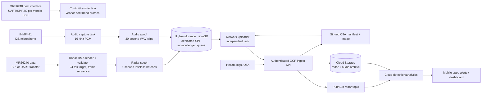

# Citraverse R6240 Room Sensor — Pilot Architecture

**Status:** proposed baseline for the five-unit pilot  
**Date:** 4 October 2026  
**Goal:** a wall-mounted, mains-powered, camera-free room sensor that reliably captures R6240 radar frames and 16 kHz mono audio, sends them to GCP, and retains unacknowledged data locally through normal Wi-Fi/cloud outages.

**Companion engineering record:** [`ESP32_S3_TWO_YEAR_RELIABILITY_AND_IO_PLAN.md`](ESP32_S3_TWO_YEAR_RELIABILITY_AND_IO_PLAN.md) verifies the dual-SPI approach, proposes the provisional pin map, and defines the two-year reliability/transport decision gates.

## 1. Scope and decisions

This is an online-first data-collection device. The cloud, not the device, owns fall detection, prolonged inactivity, unusual activity, distress-call detection, notifications, and mobile-app presentation. The node must therefore preserve signal fidelity, correct ordering, and health information; it must not make clinical claims or discard data because it cannot interpret it.

The pilot is five units: four site units and one engineering/soak-test unit. Each is high-wall mounted with a roughly 15-degree downward tilt, USB-C 5 V mains power, Wi-Fi-only connectivity, no user buttons, and clear status LEDs. The target cost is at most INR 10,000 per deployed unit, with the R6240 estimated at INR 2,000.

### Non-negotiable operating rules

1. Sensor capture never waits on Wi-Fi, TLS, cloud latency, or an SD-card upload.
2. A local item is deleted only after a server acknowledgement that it has been durably accepted.
3. Radar transport is lossless and ordered. The cloud receives every frame, packaged in one-second batches; batching is transport-only and does not downsample the 24 fps stream.
4. Audio is 30-second WAV clips (16 kHz, mono, 16-bit PCM) and is also written locally before upload.
5. Every data item has a device ID, boot ID, monotonic sequence number, capture time, format version, byte length, and CRC. The cloud deduplicates by this identity.
6. Wi-Fi/cloud failure is a degraded state, not a reason to stop sensing. Capacity limits are visible through device health and alerts.

## 2. Recommended architecture



### Why this is the right pilot topology

The existing S3 work has already proved the most important device pattern: I2S capture, SD-backed queue, and a separate uploader that releases the SD lock before a slow HTTPS transaction. This proposal retains that pattern.

It deliberately does **not** send one HTTPS request per radar frame and does **not** keep a long-lived WebSocket as the only path. At 24 fps, a connection blip would make individual requests expensive and a permanently open connection would make recovery more fragile. One-second binary batches contain all 24 frames, retry cleanly, fit the local queue model, and still reach cloud processing on about one-second cadence. Audio remains at the accepted 30-second cadence.

The MRS6240 guide says UART, SPI, and I2C can be used for configuration and data acquisition, but does not define the actual live-data protocol. We will reserve UART plus SPI2 for the radar and use SPI3 for microSD; the vendor SDK decides the production transport. The microSD must **not share the radar SPI bus**. This prevents a long SD write or file-system recovery from delaying radar capture. See `MRS6240_P2512_MODULE_REVIEW_AND_INTEGRATION_PLAN.md` for the corrected hardware facts and release gates.

The current direct-to-GCS audio path is useful pilot reference code, but the production baseline should introduce a small authenticated ingest service in front of both modalities. GCS alone is archival storage, not a reliable real-time ingress contract or device-control plane.

## 3. Device architecture

### 3.1 Compute and firmware base

- **ESP32-S3 module:** use an ESP32-S3 module with 16 MB flash and 8 MB PSRAM (N16R8 class), rather than a development board, on the custom PCB.
- **Firmware:** ESP-IDF for the production board. Existing Arduino audio/SD/upload code is the reference implementation; port it module-by-module only after repeatable bench tests prove parity. This avoids a risky wholesale rewrite before the pilot.
- **FreeRTOS tasks:**
  - `radar_control`: vendor-protocol task using UART/SPI as documented by the selected MRS6240 application firmware.
  - `radar_rx`: highest-priority DMA task; uses a vendor-confirmed polling/transfer cadence or an optional signal only if Possumic documents one. It validates frame boundaries/CRC and assigns frame sequence.
  - `audio_rx`: high priority, drains I2S/DMA into a PSRAM ring buffer.
  - `spool_writer`: sole SD writer on the independent SD SPI host; consumes radar and audio buffers and atomically renames `.part` files only after finalizing them.
  - `uploader`: reads completed objects to PSRAM, releases the SD mutex, then performs HTTPS uploads with bounded retries.
  - `health_control`: Wi-Fi state, NTP, task heartbeats, SD/radar/mic checks, LED state, logs, and OTA.
- **Memory rule:** no dynamic `String` assembly or unbounded queues on the hot paths. All network payloads are fixed-size or bounded buffers. PSRAM is used for staging, never as the only copy of unsent data.
- **No-lag rule:** the radar SPI host has its own DMA descriptors and a ping-pong receive buffer. It does not take the SD mutex and does not wait for filesystem, cloud, or audio work. Size its PSRAM ring from the measured worst-case R6240 frame size with at least five seconds of headroom; validate this under simultaneous audio, SD, and Wi-Fi load.

### 3.2 Data records and local queue

Use a small binary envelope for radar. Preserve the vendor frame bytes unchanged inside it; parse only enough to establish valid boundaries and report sensor health. This lets cloud algorithms evolve without reflashing installed units.

```text
Radar batch:  header { magic, schema=1, device_id, boot_id, batch_seq,
                       UTC start, monotonic start, frame_count, CRC32 }
              frames { frame_seq, monotonic_us, payload_length, raw_frame_bytes } x 24

Audio object: WAV (30 seconds) + object metadata { device_id, boot_id,
               clip_seq, UTC start, monotonic start, PCM format, SHA-256 }
```

Write paths:

```text
/live/radar/<seq>.part    -> /queue/radar/<seq>.r624
/live/audio/<seq>.part    -> /queue/audio/<seq>.wav
/queue/logs/<seq>.jsonl
```

The startup recovery routine finalizes or quarantines partial files, scans the queue, resumes sequence numbers, and never silently overwrites a previous object. The uploader sends oldest-first within a modality, while health messages and small control acknowledgements have priority. A failed file must not permanently block later data: after three failures it is temporarily skipped, logged, and retried with exponential backoff.

### 3.3 Storage sizing is a required engineering gate

Audio alone is **2.76 GB/day** before filesystem overhead: `16,000 × 2 bytes × 86,400`. A 64 GB card therefore holds roughly 20 days of raw audio, comfortably above the stated "few hours" outage expectation.

Radar retention cannot be sized until an R6240 capture is measured. The real value is:

```text
daily radar storage = average raw frame bytes × 24 × 86,400
```

For the schematic and pilot purchase, choose a genuine 64 GB high-endurance/industrial microSD, formatted FAT32 and validated by actual sustained-write testing. A 32 GB card can work for short outages, but 64 GB provides safer margin for this pilot. The cloud must record queue depth and projected hours remaining. At 80% used, keep capturing but raise a `storage_backlog_high` alert; at 95%, raise critical health and apply a documented retention policy rather than failing invisibly.

### 3.4 Hardware block design

```text
USB-C 5 V input
  -> USB ESD protection + 5.1k CC resistors (5 V sink, no USB-PD)
  -> resettable fuse + TVS + reverse/backfeed protection
  -> 3.3 V switched radar rail (>= 800 mA module demand, current sense)
  -> 3.3 V synchronous buck (>= 2 A peak) -> radar, ESP32-S3, mic, microSD

ESP32-S3
  -> UART/SPI2 through factory pads or board-to-board footprint -> MRS6240 vendor-confirmed host interface
  -> optional PA11/PA6 status/IRQ reservation only if vendor SDK supports it
  -> I2S -> INMP441
  -> SPI3 + dedicated DMA -> microSD socket (separate from radar bus)
  -> USB-C native USB for factory flashing/debug
  -> RGB/status LED and service/test pads
```

Use a four-layer PCB for the pilot: continuous ground plane, short power-return paths, and controlled separation of the radar, I2S microphone, the two SPI buses, Wi-Fi antenna keep-out, and switching regulator. Route the reserved MRS6240 SPI as the timing-critical interface; keep the SD bus physically separate and place its series resistors/ESD footprints near the socket. The radar antenna must face an RF-transparent plastic window; do not place copper, screws, foil, or a metal logo in front of it.

Required board details:

- keyed, locking radar connector; the R6240 is a replaceable module, not soldered directly to an unverified first PCB;
- dedicated 5 V rail/load switch for radar recovery and current measurement;
- ESD protection at USB-C and any externally reachable connector;
- boot/reset/test pads only inside the enclosure; no exposed consumer button;
- provision for measuring 3.3 V radar current, radar UART, radar SPI, optional PA11/PA6, I2S, and SD signals;
- silkscreened board serial number and QR label location;
- no SD card as a removable field-service item; it stays internal behind the enclosure.

### 3.5 Enclosure and installation

Use a two-piece 3D-printed ABS/ASA enclosure with a fixed 15-degree wall bracket, strain relief for the USB-C cable, a clear light pipe for status, and acoustic holes plus a hydrophobic mesh over the microphone. Do not put a metal grille in the radar window. Put a tamper-evident label over the service seam.

The installer must use a coverage-test mode to confirm room geometry and radar frames, measure Wi-Fi RSSI/packet loss, verify microphone input, scan/register the QR device ID, and complete a cloud round-trip test before leaving site.

## 4. Cloud contract and security baseline

### 4.1 Ingest path

For the five-unit pilot, deploy one always-warm Cloud Run ingest service with an HTTPS API. It authenticates the node, validates record envelope/CRC/schema, stores the raw payload in GCS, publishes radar-batch metadata to Pub/Sub, and returns an acknowledgement containing the accepted device/boot/sequence identity. Cloud algorithms consume Pub/Sub for near-real-time work and GCS for replay/training.

Endpoints:

```text
POST /v1/radar-batches       application/octet-stream  -> durable ACK
POST /v1/audio-clips         audio/wav                 -> durable ACK
POST /v1/health              application/json
GET  /v1/devices/<id>/manifest   -> signed OTA/config manifest
```

At five nodes, approximately five radar-batch requests per second and one audio upload every 30 seconds per node are well within this service's scope. Cloud Run should use a minimum instance of one for the pilot and stream the request body to Cloud Storage rather than buffering entire clips in memory—the earlier Cloud Run problem was application buffering/cold starts, not an inherent inability to accept audio.

The existing direct GCS resumable upload can remain as a short-term fallback for audio while the ingest service is being built. It is not the preferred long-term identity model because placing a broad GCS HMAC credential in every device increases fleet exposure.

### 4.2 Device identity and transport

- Factory program a random immutable device ID and per-device secret/certificate. Do not derive production identity solely from MAC address.
- Use TLS certificate verification; remove `setInsecure()` before a pilot device leaves the bench.
- Keep Wi-Fi credentials and device credentials in encrypted NVS.
- Enable Secure Boot v2 and flash encryption in release mode after factory provisioning is proven. Retain an internal manufacturing recovery procedure and keys; do not use development secure-boot keys in the field.
- Authenticate every request and make the cloud ACK idempotent. Retrying a batch must never create duplicate data.
- Never log Wi-Fi passwords, API keys, authorization headers, or raw audio/radar payloads in diagnostic logs.

## 5. Reliability, recovery, and OTA

### Healthy state definition

A node is healthy only when all of the following have happened in the last configured window: radar frames validated, I2S audio bytes captured with zero new drop count, SD writes succeeding, Wi-Fi associated, time synchronized, cloud health acknowledgement received, and each critical task has advanced its heartbeat.

The RGB light pipe is intentionally simple:

- green: healthy and queue below threshold;
- blue pulse: Wi-Fi/cloud unavailable but sensing and local storage healthy;
- yellow pulse: backlog draining or time awaiting sync;
- red: SD, radar, microphone, or capture-path fault;
- white fast pulse: provisioning/OTA; purple short pulse: installer test event only.

### Automatic recovery

Use task watchdogs plus a supervisor task. The supervisor restarts only a recoverable subsystem first (Wi-Fi, radar power rail, or SD re-mount); it reboots the ESP32 only if a critical task fails to advance or the capture pipeline stalls. Every reset records reset reason, queue depth, free heap, PSRAM, RSSI, sensor state, and firmware version in persistent logs. A power loss is safe because active files use `.part` plus atomic rename.

Do not use a routine nightly reboot as the primary reliability strategy. A watchdog-driven recovery, explicit health reporting, and 72-hour soak test reveal genuine faults instead of hiding them.

### OTA implementation

Use A/B application partitions with `otadata` rollback. The booted image is marked valid only after it has passed five minutes of healthy operation: SD mounted, R6240 frame stream valid, microphone capture active, Wi-Fi connected, cloud heartbeat acknowledged, and no watchdog reset. Otherwise, it automatically rolls back on the next boot.

The cloud manifest controls rollout by hardware revision and fleet cohort: engineering node first, then one pilot unit, then the remainder. Download only signed images over TLS; verify the image signature/hash before switching partitions. OTA must pause only the uploader, never corrupt the local queue; installation may occur only when capture files are safely finalized.

## 6. Costed pilot BOM target

| Item | Target INR | Notes |
|---|---:|---|
| R6240 radar module | 2,000 | User-provided estimate; lock supplier and revision before PCB layout |
| ESP32-S3 N16R8 module | 850 | Use module, not dev-board in final unit |
| INMP441 microphone | 180 | Verify genuine/consistent supplier |
| 64 GB high-endurance microSD | 650 | Include only tested card brand/SKU |
| Custom 4-layer PCB + assembly | 1,200 | Five-unit batch is expensive; target falls with volume |
| Power, USB-C, protection, connectors | 750 | Adapter/cable included |
| 5 V / 3 A certified adapter | 550 | Separate, replaceable field part |
| ABS/ASA enclosure, bracket, hardware | 900 | Includes light pipe/mesh/labels |
| Test/assembly allowance | 600 | Per-unit share of jig and burn-in work |
| Contingency | 1,000 | Supply variation, rework, spare parts |
| **Target total** | **8,680** | Leaves ~INR 1,320 below the INR 10,000 cap |

This is a planning estimate, not a purchase quote. The dominant uncertainty is the exact R6240 interface/power requirement and the low-volume PCB/enclosure price.

## 7. Failure modes: what can break, what happens, and how the pilot responds

The most dangerous failures are not simple power-off events; those are obvious. The dangerous class is **false healthy**: the unit remains powered and its LED is green, but one modality is missing, delayed, mis-timestamped, or silently corrupted. Every health report must therefore identify radar, microphone, SD, Wi-Fi, and cloud-ingest states independently.

| Failure | What the room experiences | Device response | What operations sees | Residual risk |
|---|---|---|---|---|
| UPS USB port, adapter, or cable loses power | Total sensing gap until power returns | Safe reboot; recover `.part` files; reconnect and drain queue | Device becomes offline; reset reason on return | Data during outage is unrecoverable without backup power |
| Brownout/power fluctuation | Reboots or SD write interruption | Brownout detector; atomic files; boot recovery | Reset burst / unstable-power health alert | Repeated brownouts can delay cloud uploads |
| Wi-Fi router/AP fails or signal is weak | Sensing continues, cloud is delayed | Queue to SD; retry with exponential backoff; no capture blocking | Offline after missed heartbeat; backlog depth | Queue eventually fills in a long outage |
| DNS, TLS, GCP service, quota, or credential failure | Same as internet loss, though Wi-Fi may look connected | Keep sensing and queue; classify upload error; retry | `cloud_ingest_failed` with exact HTTP/TLS/DNS cause | Must be operated as an incident before storage reaches threshold |
| SD card removed, corrupt, worn out, or full | Audio/radar can no longer be durably buffered | Red LED; SD remount/reset attempt; preserve RAM only briefly; never report healthy | `sd_fault` immediately; unit needs service if persistent | Data after RAM buffer fills is lost; use only validated high-endurance cards |
| MRS6240 stops producing vendor-valid records, returns invalid frames, or loses power | Radar is absent; audio still works | Detect missing/invalid frames; power-cycle dedicated 3.3 V rail; retry vendor configuration | `radar_fault`, frame rate, CRC and restart count | Actual room activity is unavailable until radar recovers or unit is serviced |
| MRS6240 transfer overload / firmware scheduling issue | Radar frames arrive late or are dropped | Dedicated SPI2/DMA if SPI is selected, bounded PSRAM ring; count every overflow | Frame-rate and drop-counter alarm, not a generic “online” state | Must be exposed by full-load soak testing before installation |
| INMP441 disconnects, I2S locks, becomes silent, clips, or noisy | Audio analysis is degraded/unusable; radar still works | I2S DMA health plus silence/clipping checks; restart I2S task | `mic_fault` / signal-level anomaly | A quiet room can resemble a disconnected mic; validate against baseline/noise floor |
| SD workload delays other logic | Could produce data loss in a shared-bus design | Prevented by separate SPI3; no radar transaction shares the SD bus | Bus-error and queue-latency metrics | CPU contention still requires the 72-hour combined-load test |
| Memory leak, PSRAM allocation failure, or task deadlock | Capture stops or partial service loss | Task heartbeats + watchdog; controlled reboot; persistent crash/reset log | Repeated-reset or task-stall alert | Reboot creates a short data gap; leak must be fixed in firmware |
| Wrong/missing NTP time | Data can be stored but ordered incorrectly; signed direct-GCS path may reject uploads | Use boot ID + monotonic time for ordering; queue until clock sync; record time quality | `time_unsynced`; cloud flags estimated timestamps | Correct wall-clock time cannot be reconstructed perfectly after a long offline boot |
| Failed/corrupt OTA image | Device can fail to boot new firmware | Signed image + A/B partition; health-gated confirmation; automatic rollback | OTA failure/rollback event | A hardware/flash failure may still require physical factory recovery pads |
| Enclosure moved, radar window blocked, cable tampered, water/humidity/heat | Sensor may be online but coverage or quality is wrong | Install coverage baseline; temperature/voltage checks; optional tamper switch later | Placement/quality drift must be flagged by cloud frame-quality monitoring | Physical environment can still change detection quality; periodic site inspection matters |
| Cloud algorithm or notification service fails | Data reaches cloud but caregivers get no alert | Separate end-to-end pipeline heartbeat and canary events | Application-level alerting failure, distinct from device health | Hardware LED cannot prove that an alert reached a caregiver |

### The operational response model

- **Recover automatically:** transient Wi-Fi loss, radar communication stall, I2S task stall, cloud timeout, and a failed OTA image.
- **Continue in degraded mode:** cloud unavailable while SD works; microphone fault while radar works; radar fault while microphone works. The device must explicitly identify the missing modality.
- **Require a site visit:** failed SD card, damaged cable/adapter, persistent radar hardware fault, enclosure/water damage, or a unit that repeatedly rolls back/reboots.
- **Require cloud-team action:** credential expiry, GCP quota/ingest failure, Pub/Sub/algorithm/notification outage, or a queue that is filling faster than it drains.

## 8. Pilot validation gates

No unit is installed until it passes every gate below.

1. **Radar interface proof:** capture vendor-authoritative data at the selected rate for 24 hours; verify the parser resynchronizes after injected corrupt bytes and records no unexplained drops. Exercise the chosen control/transfer path without interrupting capture.
2. **Contention proof:** 72 hours at 16 kHz/16-bit while the R6240 emits point clouds at full rate and the SD is uploading/draining; audio and radar drop counts remain zero and every WAV validates.
3. **Network proof:** disconnect Wi-Fi for two hours, then restore it; queue drains in correct order, cloud sees no duplicate/missing sequence, and capture continues throughout.
4. **Power proof:** 20 controlled power interruptions during active recording/upload; device reboots, reconnects, recovers orphan files, and resumes without manual action.
5. **Storage proof:** use the actual pilot microSD SKU for sustained writes and test a full/unreadable-card condition. The device must visibly report it.
6. **Thermal proof:** 72-hour closed-enclosure soak at the intended wall orientation; record 3.3 V rail, module temperature, Wi-Fi RSSI, heap, PSRAM, and reset count.
7. **OTA proof:** successful update, interrupted update, bad image, and rollback all pass on the engineering node before fleet rollout.
8. **Installer proof:** a non-developer completes Wi-Fi onboarding, QR registration, radar/mic/Wi-Fi test, and cloud test using the runbook.

## 9. Two-week execution sequence

### Days 1–3 — interface and data contract

- Obtain the Possumic SDK/host protocol, selected application firmware, live-data format, actual transfer interface, frame rate/size, and any optional GPIO/interrupt behavior. The module electrical guide is now reviewed.
- Make a 24-hour raw capture from the existing laptop tool and calculate average/max frame bytes and UART throughput.
- Freeze the binary radar envelope, object naming, ACK semantics, and GCS/Pub/Sub schema.

### Days 4–7 — integrated bench node

- Port the vendor-confirmed MRS6240 host transport to the S3, while preserving the proven audio/SD queue architecture.
- Add radar batching, sequence/retry/recovery, cloud health, and fault-injection tests.
- Build/validate the Cloud Run ingest API with streaming writes and idempotent ACKs.

### Days 8–10 — PCB/enclosure freeze

- Freeze schematic only after the R6240 electrical facts and sustained-load current are measured.
- Produce 4-layer PCB, test-jig, and enclosure design; order five pilot boards plus one spare board and extra cards/connectors.

### Days 11–14 — reliability and deployment readiness

- Assemble the engineering unit first; complete the validation gates above as far as time permits.
- Manufacture the remaining units only after the engineering unit has a clean 72-hour run.
- Produce a serial-number register, factory checklist, installer runbook, and rollback/retrieval procedure.

## 10. Items that must be confirmed before schematic freeze

1. The Possumic SDK and host communication protocol: live-data format, selected transfer interface, application firmware, data rate, and optional status/interrupt behavior. The reviewed electrical guide alone does not provide this protocol.
2. Measured R6240 average/max raw frame size and actual output rate. This determines UART margin, SD growth, and cloud payload size.
3. The approved GCP project, bucket location/lifecycle policy, domain/certificate, and service identity model.
4. The exact pilot adapter/cable and whether the site UPS USB port can continuously supply 5 V at the measured peak current.

## 11. Design record provenance

This recommendation uses the existing Citraverse S3 audio implementation as a proven pattern: dual capture/upload tasks, PSRAM staging, SD mutex, queue recovery, resumable uploads, event logs, and LED health. It does not reuse older C1001 fall logic because this pilot intentionally sends R6240 data to cloud algorithms. Earlier documents about RD-03D, C1001, LD2450, and LD6003D are treated as historical reference only; they do not override the requested R6240, Wi-Fi-only, direct-to-cloud pilot scope.
